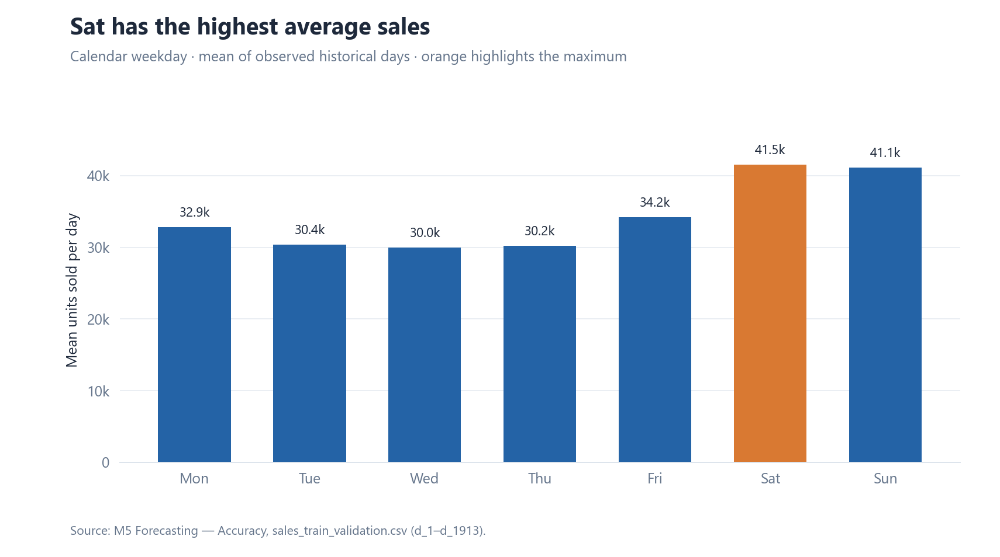
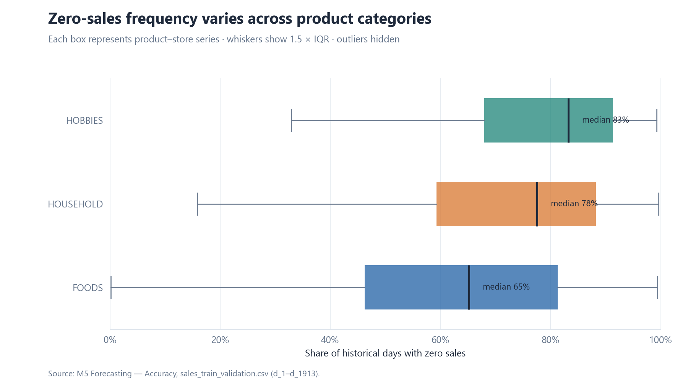
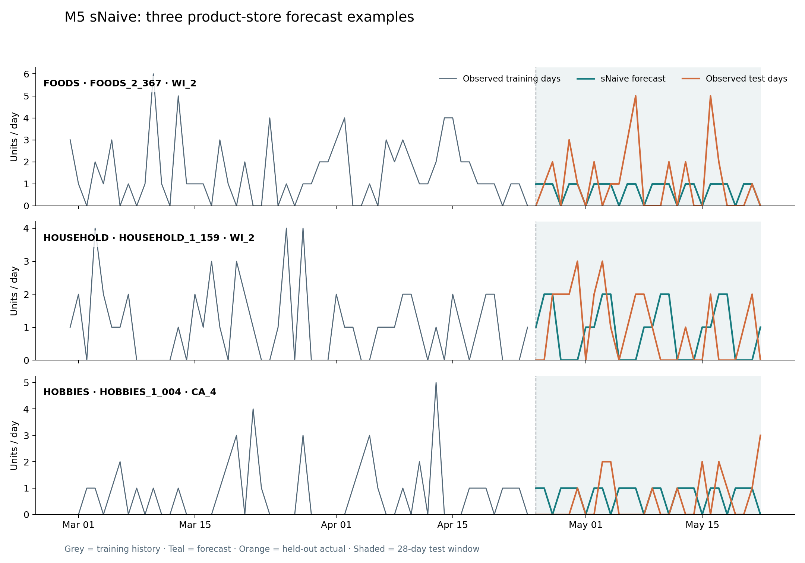
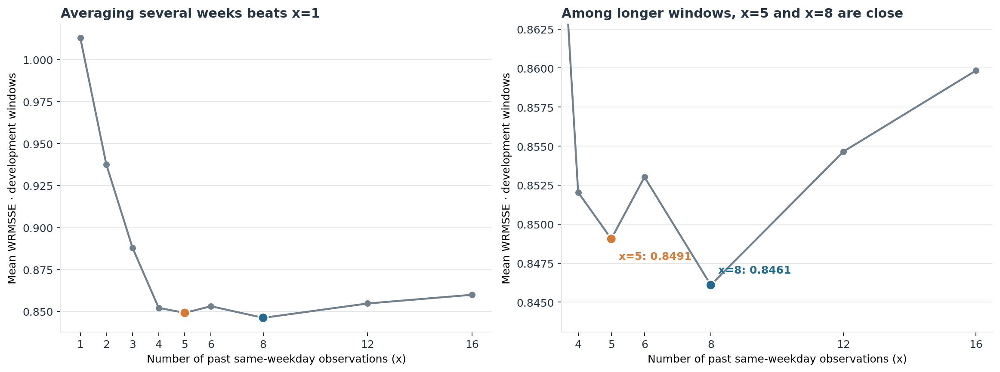
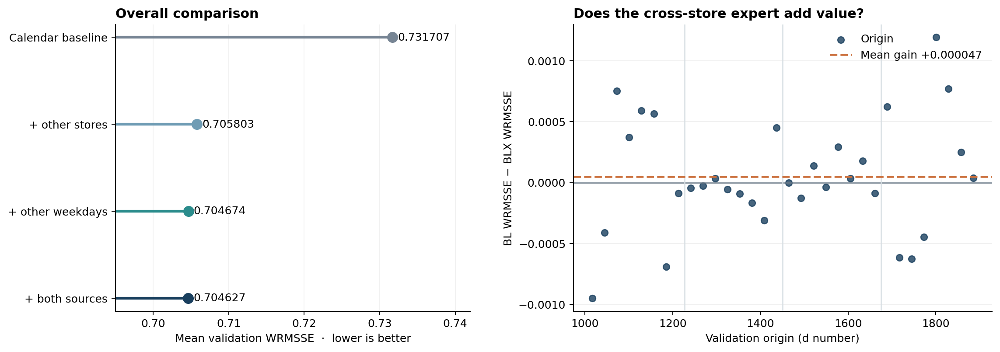
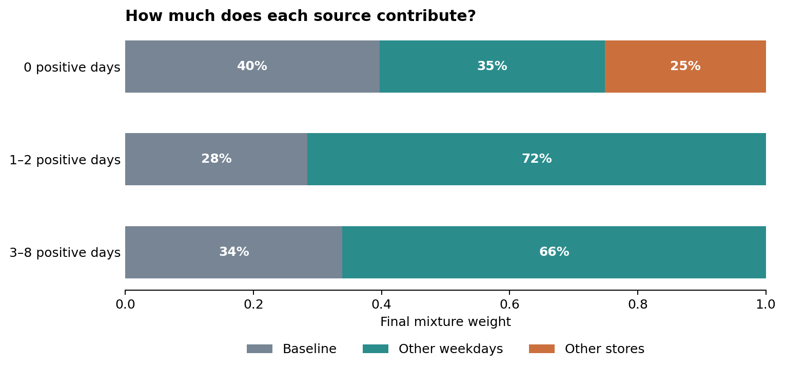

# M5 Sales Forecasting Explorations

**Starting with "repeat last week," this project asks how much history to use, how strongly to favor recent observations, how to adjust for calendar effects, and where sparse series can borrow information.**

This project uses the M5 Forecasting - Accuracy dataset to predict **28 days** of daily sales for all **30,490 item-store series**. Each experiment addresses a concrete question and retains its candidate comparisons, parameters, and results.

The final method is a **BLX information-borrowing mixture**. On the local holdout from `d_1914` to `d_1941`, 12-level WRMSSE falls from **0.86970** for seasonal naive to **0.65357**, a relative reduction of approximately **24.85%**.

## Contents

- [Task, data, and evaluation](#task-data-and-evaluation)
- [1. Understand the data: weekday patterns and many zeros](#1-understand-the-data-weekday-patterns-and-many-zeros)
- [2. Establish a simple baseline: repeat last week](#2-establish-a-simple-baseline-repeat-last-week)
- [3. Reduce single-week noise: how many weeks should be averaged?](#3-reduce-single-week-noise-how-many-weeks-should-be-averaged)
- [4. Balance stability and change: weight recent history](#4-balance-stability-and-change-weight-recent-history)
- [5. Test trend extrapolation](#5-test-trend-extrapolation)
- [6. Adjust for known date differences: holidays and SNAP](#6-adjust-for-known-date-differences-holidays-and-snap)
- [7. Inspect sparse-series errors](#7-inspect-sparse-series-errors)
- [8. Borrow information from other weekdays and stores](#8-borrow-information-from-other-weekdays-and-stores)
- [Final results and lessons](#final-results-and-lessons)
- [Code structure and reproduction](#code-structure-and-reproduction)

## Task, data, and evaluation

### Forecasting target

Each series records daily sales of one item in one store.

| Dimension | Size |
|---|---:|
| Items | 3,049 |
| Stores | 10 |
| States | CA, TX, WI |
| Categories | FOODS, HOBBIES, HOUSEHOLD |
| Item-store series | 30,490 |
| Initial history | 1,913 days |
| Forecast horizon | 28 days |

Inputs consist of sales, a calendar, and weekly prices. The calendar provides events and state-specific SNAP flags. Prices determine revenue weights and help identify the first release date of each item-store series.

### Model comparison

The primary metric is **WRMSSE; lower is better**. Evaluation covers leaf item-store series and aggregates such as total sales, states, stores, categories, and items: **12 levels and 42,840 nodes** in total.

Each node's forecast error is scaled by its historical variation and weighted by its revenue over the 28 days preceding the forecast origin. The final score averages the 12 level scores equally. A model therefore needs to predict individual series while preserving aggregate sales patterns.

### Temporal splits

| Period | Purpose |
|---|---|
| `d_1`-`d_1913` | Historical exploration, rolling backtests, and parameter fitting |
| `d_1914`-`d_1941` | Final 28-day local holdout |
| `d_1942`-`d_1969` | Next-stage predictions after advancing the forecast origin |

Rolling experiments use 64 origins, beginning at `d_121` and advancing by 28 days through `d_1885`. Each origin simulates predicting the next 28 days using history available at that date.

Window selection uses 32 development, 16 confirmation, and 16 audit origins. The rho, calendar, and mixture experiments use four expanding folds: fit on the first 32, 40, 48, or 56 origins, then validate on the following eight. Tables below identify their evaluation periods; candidates within each table share the same windows.

Some early-origin nodes have a zero RMSSE scale. Rolling scores exclude those nodes and renormalize weights within each level; `origin_metric_coverage.csv` records the excluded shares. The final holdout uses the full 12-level scoring implementation.

## Experiment roadmap

~~~mermaid
flowchart TD
    A["Audit data; inspect weekdays and zeros"] --> B["Seasonal naive: repeat last week"]
    B --> C["Select same-weekday window x"]
    C --> D["Fix x=8; select grouped recency factor rho"]
    D --> E["Add holiday and SNAP adjustments"]
    D --> T["Branch: compare constant, linear, and damped trends"]
    T --> U["Retain the constant level"]
    E --> F["Diagnose sparse-series errors and calibration"]
    F --> G["Mix B, other-weekday L, and cross-store X"]
    G --> H["Final BLX model and submission export"]
~~~

## 1. Understand the data: weekday patterns and many zeros

**What structure is present in daily sales, and how should zeros be interpreted?**

The audit checks sales layout, duplicate IDs, missing and invalid values, hierarchy assignments, the date axis, and price records. Preparation then separates the original wide table into a sales matrix and an aligned metadata table.

Approximately **68.20% of cells in the full training matrix are zero**. A zero may represent a day without sales or a date before an item was released. Subsequent models use the first price record to identify release dates and retain observed zeros after release.

Weekday summaries show clear differences. Historical mean total sales are approximately **41,500 units on Saturday**, **41,100 on Sunday**, and **30,000 on Wednesday**. This motivates using the same weekday in previous weeks as a starting point.

Sparsity also differs across categories. A single overall zero-sales share does not describe every product.

**Modeling direction: preserve weekday structure, distinguish pre-release dates from observed zeros, and revisit sparse series during error analysis.**

Code: `data_prep/01_audit_raw.py` through `04_plot_eda.py`. See [data preparation](code/data_prep/README.md) for details.

## 2. Establish a simple baseline: repeat last week

**Given the weekday pattern, how well does copying the latest week predict the future?**

Seasonal naive (sNaive) takes the last seven daily sales and repeats that profile four times. It retains within-week differences and provides a clear reference for each later modification.

The local holdout WRMSSE is **0.86970**.

This baseline depends entirely on one week. An unusual Monday is copied into all four forecast Mondays. The next experiment therefore averages multiple matching weekdays to reduce single-week noise.

Code: [01_snaive_wrmsse.py](code/evaluation/01_snaive_wrmsse.py). Results: [score summary](outputs/evaluation/snaive/snaive_wrmsse_summary.json).

## 3. Reduce single-week noise: how many weeks should be averaged?

**More observations can smooth noise, but older data may describe an outdated sales level. How long should the window be, and should categories use different windows?**

The candidate windows are:

~~~text
x in {1, 2, 3, 4, 5, 6, 8, 12, 16}
~~~

For a Monday forecast, average up to x eligible historical Mondays. Repeat the resulting weekday profile across the four forecast weeks.

The experiment compares:

- **A shared window:** all three categories use the same x.
- **Category-specific windows:** FOODS, HOBBIES, and HOUSEHOLD select separate windows, giving 729 vectors.

Development selects **(4, 8, 8)** as the category vector and **8** as the shared window. Confirmation then compares those fixed candidates with sNaive.

| Method | Development WRMSSE | Confirmation WRMSSE | Audit WRMSSE |
|---|---:|---:|---:|
| sNaive, x=1 | 1.01311 | 0.95661 | 0.97628 |
| Category windows (4, 8, 8) | 0.84336 | 0.80758 | 0.79899 |
| Shared x=8 | 0.84610 | **0.80186** | 0.80530 |

The confirmation decision adopts **shared x=8**. The category vector scores better on audit, illustrating that their relative performance varies over time; subsequent experiments retain the shared window chosen on confirmation.

The visualization stage additionally computes x=5 confirmation scores to inspect its difference from x=8, saving the paired comparison.

**Decision: use eight matching weekdays to build a more stable weekly profile.**

Code: [02_select_x_wrmsse.py](code/evaluation/02_select_x_wrmsse.py), [03_visualize_x_selection.py](code/evaluation/03_visualize_x_selection.py). Results: [split comparison](outputs/evaluation/x_selection/selected_vector_split_scores.csv).

## 4. Balance stability and change: weight recent history

**Should observations from eight weeks ago receive the same weight as last week? Do states and categories change at different rates?**

With x fixed at 8, replace equal weights with recency weights:

~~~text
w_k proportional to rho^k
k=0 denotes the newest matching-weekday observation.
Each additional week into the past increases k by one.
~~~

Weights are normalized over eligible observations. Smaller rho values emphasize recent history; rho=1 gives an equal-weight eight-week mean, while rho=0 uses the latest eligible matching weekday.

Coordinate descent searches rho under four parameter-sharing structures:

| Grouping | Number of rho values | Four-fold validation mean WRMSSE |
|---|---:|---:|
| Global | 1 | 0.79928 |
| State | 3 | 0.79898 |
| State x category | 9 | **0.79881** |
| Store x category | 30 | 0.79882 |

Selection uses paired loss differences and moving-block bootstrap standard errors, preferring the simplest grouping eligible under the one-standard-error rule. It selects **nine state-category rho values**.

The local holdout WRMSSE is **0.73699**. The more detailed store-category grouping does not improve the mean validation score.

**Decision: retain eight weeks of history, while allowing each state-category group to control how strongly recent observations matter.**

Code: [04_select_rho_wrmsse.py](code/evaluation/04_select_rho_wrmsse.py). Results: [grouping comparison](outputs/evaluation/rho_selection/partition_validation_summary.csv), [final rho values](outputs/evaluation/rho_selection/learned_rho_final.csv).

## 5. Test trend extrapolation

**Recency weighting follows changing levels. Should a recent increase or decrease also be extrapolated into the next four weeks?**

This branch aggregates the latest eight complete weeks within each state-category group and fits a rho-weighted least-squares slope. It compares:

- **Constant:** repeat the existing weighted weekday profile.
- **Linear:** continue the estimated slope.
- **Damped:** reduce the trend contribution at more distant horizons.

| Method | Confirmation mean WRMSSE |
|---|---:|
| Constant level | **0.79963** |
| Linear trend | 0.83897 |
| Development-selected damped trend | 0.81243 |

The comparison selects the **constant level**. In this experiment, slopes estimated from the recent eight weeks do not support better extrapolation. The main modeling path continues with the weighted weekday profile.

Code: [05_grouped_trend_wrmsse.py](code/evaluation/05_grouped_trend_wrmsse.py). Results: [split comparison](outputs/evaluation/grouped_trend/split_summary.csv).

## 6. Adjust for known date differences: holidays and SNAP

**Matching weekdays can still have different sales conditions. Can known holiday and SNAP differences between historical and forecast dates improve predictions?**

Add a calendar multiplier to the grouped-rho baseline:

~~~text
Target-day multiplier = exp(beta_g * SNAP + sum(gamma_e * event_e))
~~~

SNAP coefficients are state-category specific. Four holidays share event coefficients across groups: Pesach End, OrthodoxEaster, Cinco De Mayo, and Mother's day. Historical references are adjusted first, then target-day effects are applied.

Parameters are fitted with a group-total Poisson negative log likelihood, ridge penalties, and bounded log multipliers. Four candidates are compared:

| Candidate | Four-fold validation mean WRMSSE |
|---|---:|
| Rho baseline | 0.79881 |
| Holidays only | 0.79258 |
| SNAP only | 0.73975 |
| Holidays + SNAP | **0.73171** |

The selected model is **both: holidays plus SNAP**. Its local holdout WRMSSE is **0.66136**.

**Decision: retain recency-weighted weekday structure and use calendar factors to explain additional target-date differences.**

Code: [06_calendar_effect_wrmsse.py](code/evaluation/06_calendar_effect_wrmsse.py). Results: [validation comparison](outputs/evaluation/calendar_effect/validation_model_summary.csv), [final coefficients](outputs/evaluation/calendar_effect/final_calendar_coefficients.csv).

## 7. Inspect sparse-series errors

**For products that frequently sell nothing, is the main problem overforecasting on zero-sales days or missing demand on days with sales?**

Reconstruct validation forecasts and group series by release history and their zero-sales share over the last 56 days. Inspect zero-day errors, nonzero-day errors, and unconditional calibration separately.

For mature series with at least 80% zero sales in the historical window, the calendar model produces these pooled statistics across 32 validation origins:

| Statistic | Result |
|---|---:|
| Actual mean sales over all target days | 0.2340 |
| Forecast mean sales over all target days | 0.1192 |
| Share of target days with at least 3 units sold | 1.78% |
| Share of squared error contributed by those days | 83.34% |
| Frequency of at least 3 units sold in the top forecast decile | 4.64% |

This suggests a concrete improvement target: **the high-sparsity cohort is underpredicted overall, and relatively few higher-sales days account for most squared error.** Larger predictions also correspond to a higher observed frequency of larger sales, indicating useful discrimination in the existing forecasts.

Eight matching weekdays provide at most eight references for each weekday position. All eight can happen to be zero for a sparse item. The next step broadens the information used to estimate its sales level.

Code: [07_sparse_zero_diagnostic.py](code/evaluation/07_sparse_zero_diagnostic.py). Results: [pooled sparse-series diagnostics](outputs/evaluation/sparse_zero_diagnostic/sparse_unconditional_pooled.csv).

## 8. Borrow information from other weekdays and stores

**When same-weekday samples are thin, can the same item's other weekdays or other stores provide useful information?**

Add two forecast components to the existing calendar model B:

| Component | Information source | Approach |
|---|---|---|
| **B** | Same-weekday history of the current item-store series | Recency weighting and holiday/SNAP adjustments |
| **L_perp** | Other weekdays of the same item-store series | Remove weekday and calendar effects, estimate the level, then restore target-day factors |
| **X** | The same item in other stores | Convert de-calendarized sales using shrunk store-share estimates |

L_perp uses released, non-event days from the preceding 56 days, excluding the target weekday. Weekday multipliers are estimated from the previous 364 days. X also uses 56 days and compares store-share shrinkage values `kappa={5,20,80}`.

Reliability bins use the number of positive observations among the previous eight matching weekdays: **0**, **1-2**, or **at least 3**. Each bin learns three weights for B, L_perp, and X, summing to one.

### Which information improves the forecast?

| Candidate | Four-fold validation mean WRMSSE |
|---|---:|
| B: calendar baseline | 0.73171 |
| BL: add other weekdays | 0.70467 |
| BX: add other stores, kappa=5 | 0.70580 |
| BLX: add both, kappa=80 | **0.70463** |

Selection chooses **BLX with kappa=80**. Either information source improves B on its own. BL is already close to the full mixture; adding X to BL improves the validation mean by approximately **0.000047**.

### How does the final model allocate weights?

| Positive observations among eight matching weekdays | B | L_perp | X |
|---|---:|---:|---:|
| 0 | 39.71% | 35.20% | 25.09% |
| 1-2 | 28.43% | 71.57% | Approximately 0% |
| At least 3 | 33.90% | 66.10% | Approximately 0% |

**The main improvement comes from using more of the same store's history; cross-store weights concentrate in the bin with no positive same-weekday observations.** The final model preserves the original weekly baseline, uses other weekdays broadly, and supplements the weakest same-weekday histories with cross-store information.

Code: [08_borrow_information_wrmsse.py](code/evaluation/08_borrow_information_wrmsse.py). Results: [candidate scores](outputs/evaluation/borrow_information/validation_candidate_summary.csv), [final weights](outputs/evaluation/borrow_information/final_mixture_weights.csv).

## Final results and lessons

The following scores use the same local holdout, `d_1914` through `d_1941`, and **12-level WRMSSE**.

| Method | WRMSSE | Result source |
|---|---:|---|
| Seasonal naive | 0.86970 | [Baseline summary](outputs/evaluation/snaive/snaive_wrmsse_summary.json) |
| Eight-week history + state-category recency weights | 0.73699 | [Rho holdout score](outputs/evaluation/rho_selection/final_holdout_score.json) |
| Rho + holidays | 0.71941 | [Calendar summary](outputs/evaluation/calendar_effect/experiment_summary.json) |
| Rho + SNAP | 0.68630 | Same as above |
| Rho + holidays + SNAP | 0.66136 | Same as above |
| BLX information-borrowing mixture | **0.65357** | [Mixture summary](outputs/evaluation/borrow_information/experiment_summary.json) |

The experiments lead to five practical observations:

1. **Preserve weekday structure and average multiple weeks to reduce single-week noise.** Compare windows across time; the shared eight-week choice wins confirmation here.
2. **Share recency parameters at a useful group level.** Nine state-category parameters work well; finer store-category groups do not improve the validation mean.
3. **Test whether trends should be extrapolated.** This branch retains a constant forecast level.
4. **Known calendar information has predictive value.** Joint holiday and SNAP adjustment outperforms either adjustment alone.
5. **Sparse series benefit from broader references.** Both other weekdays and other stores improve the baseline. Within the final mixture, local history carries most of the gain and the cross-store increment is small and concentrated.

These findings describe the periods and candidate set examined here. The model still uses an eight-week reference window, multiplicative calendar effects, and three reliability bins. Prices determine revenue weights and release dates but are not direct demand features. Further experiments could compare history lengths, reliability definitions, and the contribution of price changes.

## Submission export

After fitting the mixture, run `09_build_kaggle_submission.py`:

1. Reuse the frozen `d_1914`-`d_1941` validation predictions.
2. Append the newly observed 28 days to history, advancing the origin to `d_1941`.
3. Keep the selected rho, calendar coefficients, kappa, and mixture weights to predict `d_1942`-`d_1969`.
4. Align both parts to the template IDs and save `outputs/submission/m5_accuracy_submission.csv`.

The submission contains **60,980 rows and 29 columns**, named `id,F1,...,F28`. Scores above are local holdout scores; the submission CSV is generated locally.

## Code structure and reproduction

### Repository contents

~~~text
project-root/
├─ README.md
├─ requirements.txt
├─ .gitignore
├─ code/
│  ├─ data_prep/               Audit, conversion, exploratory statistics, and plots
│  └─ evaluation/              Forecast experiments numbered 01-09
├─ data/
│  ├─ README.md                Download instructions
│  ├─ m5-forecasting-accuracy/  Created when raw CSVs are downloaded
│  └─ processed/               Generated by preparation scripts
└─ outputs/
   ├─ README.md                Selected-results index
   ├─ data_prep/               Exploratory plots and data-quality reports
   ├─ evaluation/              Selected scores, parameters, summaries, and figures
   └─ submission/              Generated by the submission exporter
~~~

Raw data, the Python environment, and full prediction tables remain local. The repository includes reproduction code and selected results. Scripts resolve the project root from their own locations.

### Environment and data

Run the following in Windows PowerShell from the project root:

~~~powershell
python -m venv .venv
.\.venv\Scripts\python.exe -m pip install -r requirements.txt
~~~

The existing local environment uses Python 3.10.1; dependency versions are listed in `requirements.txt`. Download these files from the [Kaggle data page](https://www.kaggle.com/competitions/m5-forecasting-accuracy/data) and place them under `data/m5-forecasting-accuracy/` as described in the [data instructions](data/README.md):

- `sales_train_validation.csv`
- `sales_train_evaluation.csv`
- `calendar.csv`
- `sell_prices.csv`
- `sample_submission.csv`

### Prepare and inspect the data

~~~powershell
.\.venv\Scripts\python.exe code/data_prep/01_audit_raw.py
.\.venv\Scripts\python.exe code/data_prep/02_prepare_clean.py
.\.venv\Scripts\python.exe code/data_prep/03_summarize_eda.py
.\.venv\Scripts\python.exe code/data_prep/04_plot_eda.py
~~~

`05_plot_calendar.py` independently generates calendar figures. See [data preparation](code/data_prep/README.md) for statistics and output definitions.

### Reproduce the forecasting path

~~~powershell
.\.venv\Scripts\python.exe code/evaluation/01_snaive_wrmsse.py
.\.venv\Scripts\python.exe code/evaluation/02_select_x_wrmsse.py
.\.venv\Scripts\python.exe code/evaluation/04_select_rho_wrmsse.py
.\.venv\Scripts\python.exe code/evaluation/06_calendar_effect_wrmsse.py
.\.venv\Scripts\python.exe code/evaluation/08_borrow_information_wrmsse.py
.\.venv\Scripts\python.exe code/evaluation/09_build_kaggle_submission.py
~~~

Experiment 03 visualizes window selection, 05 compares trends, and 07 diagnoses sparse-series errors. Parameter grids, outputs, and resume options are documented in [forecasting experiments](code/evaluation/README.md). More figures are available in the [selected-results index](outputs/README.md).

## Data sources

- [Kaggle M5 Forecasting - Accuracy](https://www.kaggle.com/competitions/m5-forecasting-accuracy/data)
- [M5 organizers' repository](https://github.com/Mcompetitions/M5-methods)
