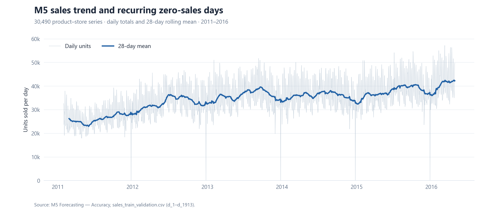
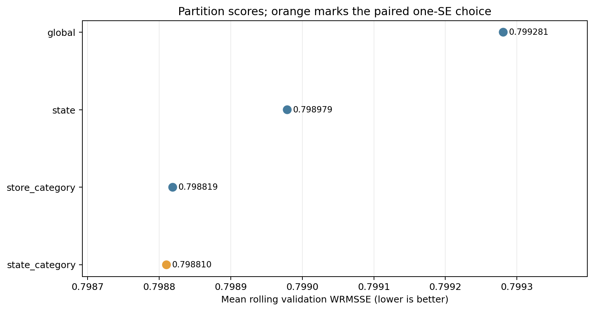
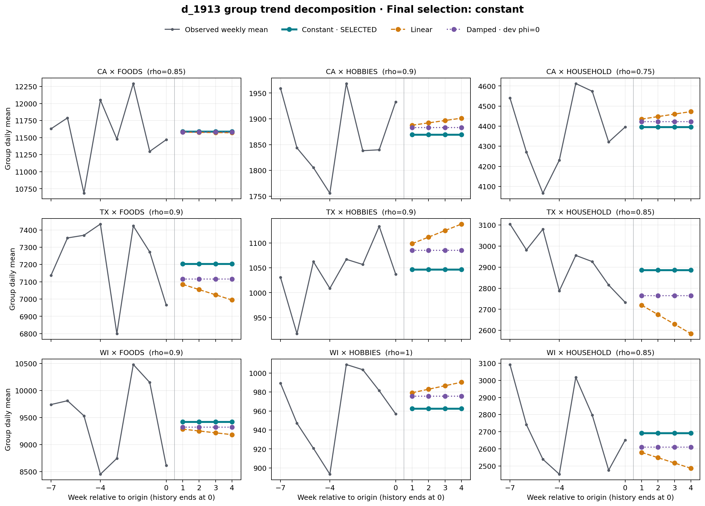
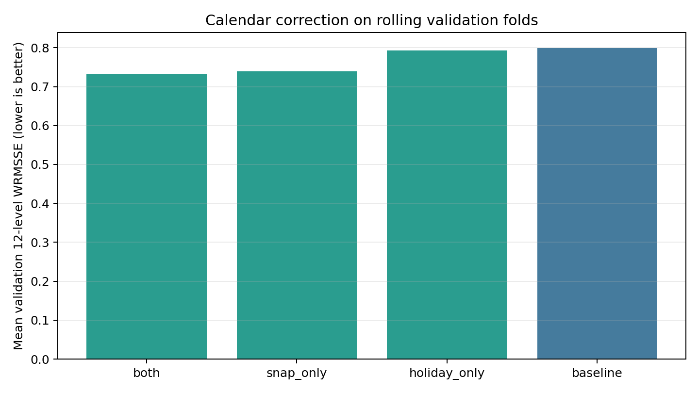
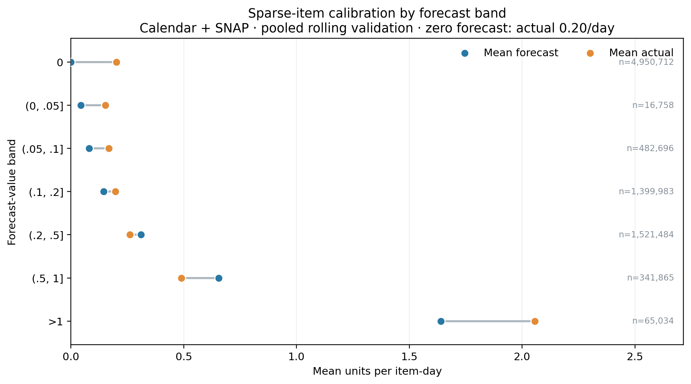

# M5 销量预测探索

**从“下周沿用上周”开始，逐步回答：历史应该看多长、近期信息有多重要、日历效应如何修正，以及稀疏序列能向谁借信息？**

本项目使用 M5 Forecasting — Accuracy 数据集，对全部 **30,490 条商品×门店序列**预测未来 **28 天**的日销量。实验围绕一系列具体问题展开，每一步保留候选比较、参数和结果。

最终采用 **BLX 信息共享混合模型**。在 `d_1914` 至 `d_1941` 的本地留出期，12 层级 WRMSSE 从季节性朴素基线的 **0.86970** 降至 **0.65357**，相对降低约 **24.85%**。

## 阅读导航

- [任务、数据与评价](#任务数据与评价)
- [1. 先理解数据：星期规律与大量零销量](#1-先理解数据星期规律与大量零销量)
- [2. 从简单基线开始：复制上周](#2-从简单基线开始复制上周)
- [3. 减少单周噪声：平均过去多少周](#3-减少单周噪声平均过去多少周)
- [4. 兼顾稳定与变化：给近期历史更高权重](#4-兼顾稳定与变化给近期历史更高权重)
- [5. 尝试趋势外推：销量水平需要继续上升或下降吗](#5-尝试趋势外推销量水平需要继续上升或下降吗)
- [6. 修正已知日期差异：节日与 SNAP](#6-修正已知日期差异节日与-snap)
- [7. 回看误差：稀疏序列的问题在哪里](#7-回看误差稀疏序列的问题在哪里)
- [8. 扩大信息来源：同店其他星期与其他门店](#8-扩大信息来源同店其他星期与其他门店)
- [最终结果与收获](#最终结果与收获)
- [代码结构与复现](#代码结构与复现)

## 任务、数据与评价

### 预测对象

每条序列对应一个商品在一家门店的每日销量。数据包含：

| 维度 | 规模 |
|---|---:|
| 商品 | 3,049 种 |
| 门店 | 10 家 |
| 州 | CA、TX、WI |
| 品类 | FOODS、HOBBIES、HOUSEHOLD |
| 商品×门店序列 | 30,490 条 |
| 初始历史长度 | 1,913 天 |
| 每次预测长度 | 28 天 |

输入由销量、日历和周价格构成。日历包括节日与各州 SNAP 标记；价格用于销售额权重和首次开售日期的识别。

### 如何比较模型

主指标为 **WRMSSE，数值越低越好**。它评价商品×门店底层序列，也评价总销量、州、门店、品类、商品等汇总层级，共 **12 层、42,840 个节点**。

每个节点先按自身历史变化幅度缩放预测误差，再以当前预测起点最近 28 天的销售额加权；最后对 12 个层级的得分取等权平均。模型因此既要预测单条序列，也要兼顾汇总后的销售规模。

### 时间划分

| 时间范围 | 用途 |
|---|---|
| `d_1`—`d_1913` | 历史分析、滚动回测和参数拟合 |
| `d_1914`—`d_1941` | 最后 28 天的本地留出期评价 |
| `d_1942`—`d_1969` | 将历史推进后，生成提交文件下一阶段的预测 |

滚动实验设置 64 个起点，从 `d_121` 开始，每次向后移动 28 天，最后一个起点为 `d_1885`。每个起点模拟“截至当天预测未来 28 天”。

窗口 x 的选择使用“32 个开发起点＋16 个确认起点＋16 个审计起点”；rho、日历和混合模型使用四折扩展窗口，分别在前 32、40、48、56 个起点拟合，并在随后八个起点验证。下文各表标明对应评价范围，同表内比较相同窗口的候选。

滚动初期部分节点的 RMSSE 缩放分母为零，评分时将其排除并在层级内重新归一化权重；覆盖情况记录在各实验的 `origin_metric_coverage.csv`。最后留出期使用完整的 12 层级评分。

## 实验路线

~~~mermaid
flowchart TD
    A["审计数据、观察星期规律和零销量"] --> B["季节性朴素：复制上周"]
    B --> C["选择同星期平均窗口 x"]
    C --> D["固定 x=8，选择分组近期权重 rho"]
    D --> E["加入节日与 SNAP 修正"]
    D --> T["分支：比较水平不变、线性与阻尼趋势"]
    T --> U["选择水平不变"]
    E --> F["诊断稀疏序列的误差与校准"]
    F --> G["混合 B、同店其他星期 L、跨门店 X"]
    G --> H["最终 BLX，生成提交文件"]
~~~

## 1. 先理解数据：星期规律与大量零销量

**首先要回答：销量主要呈现什么结构，零值应该怎样处理？**

数据审计检查销量结构、重复 ID、缺失和异常数值、分类归属、日期轴和价格记录。随后将原始宽表拆成销量矩阵与身份表，保留原始行顺序。

全训练矩阵约 **68.20% 的销量单元格为零**。这些零值包含不同情形：某天没有销量，也可能属于商品开售之前的日期。后续建模用首次价格记录识别开售时点，开售后的零销量仍作为有效观测。

星期汇总显示明显的周内差异：历史上星期六、星期日的平均总销量约为 **4.15 万、4.11 万件**，星期三约为 **3.00 万件**。这使“参考过去相同星期的销量”成为自然的起点。

不同品类的零销量分布也不相同，单一平均值无法概括所有商品。

**这一阶段形成的建模方向：保留星期结构，区分开售前后，并在后续专门检查稀疏序列。**

代码：`data_prep/01_audit_raw.py`—`04_plot_eda.py`。详细流程见[数据准备说明](code/data_prep/README.md)。

## 2. 从简单基线开始：复制上周

**既然存在星期规律，直接用上周对应日期预测未来，会有多大误差？**

季节性朴素方法（sNaive）取最后七天销量，将这条星期曲线重复四次。它保留周内差异，也给后续每一个改动提供明确对照。

本地留出期 WRMSSE 为 **0.86970**。

这个基线依赖最近一周：如果其中一个星期一销量异常，未来四个星期一都会继承这次异常。因此，下一步尝试汇总多周的同星期观测，降低单周波动的影响。

代码：[01_snaive_wrmsse.py](code/evaluation/01_snaive_wrmsse.py)。结果：[评分摘要](outputs/evaluation/snaive/snaive_wrmsse_summary.json)。

## 3. 减少单周噪声：平均过去多少周？

**增加历史样本有助于平滑噪声，但更久以前的数据也可能不再代表当前水平。窗口应该多长？不同品类需要不同窗口吗？**

比较的窗口为：

~~~text
x ∈ {1, 2, 3, 4, 5, 6, 8, 12, 16}
~~~

例如预测星期一，就取过去 x 个有效星期一的平均销量，并对未来四周重复使用同一星期模式。

实验同时比较：

- **统一窗口**：三个品类使用相同 x。
- **品类组合**：FOODS、HOBBIES、HOUSEHOLD 分别选择窗口，共 729 种组合。

开发期找到的品类组合为 **(4, 8, 8)**，最优统一窗口为 **8**。随后比较这两个固定候选与 sNaive：

| 方法 | 开发期 WRMSSE | 确认期 WRMSSE | 审计期 WRMSSE |
|---|---:|---:|---:|
| sNaive，x=1 | 1.01311 | 0.95661 | 0.97628 |
| 品类窗口 (4, 8, 8) | 0.84336 | 0.80758 | 0.79899 |
| 统一窗口 x=8 | 0.84610 | **0.80186** | 0.80530 |

根据确认期结果，后续采用 **统一 x=8**。审计期中品类组合的分数更低，说明两者的相对表现会随时间变化；后续实验延续确认期选定的统一八周方案。

另补算 x=5 的确认期得分，用于解释它与 x=8 的差异，保存在配对比较表中。

**这一阶段的选择：用最近八周的同星期数据建立更稳定的星期曲线。**

代码：[02_select_x_wrmsse.py](code/evaluation/02_select_x_wrmsse.py)、[03_visualize_x_selection.py](code/evaluation/03_visualize_x_selection.py)。结果：[分阶段比较表](outputs/evaluation/x_selection/selected_vector_split_scores.csv)。

## 4. 兼顾稳定与变化：给近期历史更高权重

**八周平均提高了稳定性，但八周前与上周的信息应该同样重要吗？不同地区和品类是否变化得快慢不同？**

固定 x=8，将等权平均改为近期加权：

~~~text
w_k ∝ rho^k
k=0 对应最近一次同星期观测，随后每向前一周，k 增加 1。
~~~

权重在有效观测中归一化。rho 越小，越偏重近期；rho=1 对应等权八周平均，rho=0 对应最近一次有效同星期观测。

实验比较四种共享参数的范围，并通过坐标下降搜索各组 rho：

| 分组方式 | rho 数量 | 四折验证平均 WRMSSE |
|---|---:|---:|
| 全局 | 1 | 0.79928 |
| 州 | 3 | 0.79898 |
| 州×品类 | 9 | **0.79881** |
| 门店×品类 | 30 | 0.79882 |

参数选择结合配对损失差和移动块自助抽样标准误，在符合单标准误规则的候选中优先选择简单分组。最终采用 **州×品类的九个 rho**。

对应本地留出期 WRMSSE 为 **0.73699**。门店×品类的更细分组没有带来验证均分的进一步改善。

**这一阶段的选择：保留八周历史，同时让九个州×品类组各自决定近期信息的重要程度。**

代码：[04_select_rho_wrmsse.py](code/evaluation/04_select_rho_wrmsse.py)。结果：[分组比较](outputs/evaluation/rho_selection/partition_validation_summary.csv)、[最终 rho](outputs/evaluation/rho_selection/learned_rho_final.csv)。

## 5. 尝试趋势外推：销量水平需要继续上升或下降吗？

**近期加权能更快跟随水平变化，是否还应该把最近的上升或下降继续外推到未来四周？**

这一分支在州×品类组内汇总最近八个完整周，用 rho 加权最小二乘拟合趋势，比较：

- **水平不变**：未来四周沿用已有加权星期曲线。
- **线性趋势**：将估计斜率继续向前延伸。
- **阻尼趋势**：让趋势对更远未来的影响逐渐减弱。

| 方法 | 确认期平均 WRMSSE |
|---|---:|
| 水平不变 | **0.79963** |
| 线性趋势 | 0.83897 |
| 开发期选定的阻尼趋势 | 0.81243 |

结果选择 **水平不变**。这次实验中，最近八周估计出的趋势不足以支持更好的外推预测，因此主线继续使用已有的加权星期曲线。

代码：[05_grouped_trend_wrmsse.py](code/evaluation/05_grouped_trend_wrmsse.py)。结果：[阶段比较](outputs/evaluation/grouped_trend/split_summary.csv)。

## 6. 修正已知日期差异：节日与 SNAP

**相同星期不一定具有相同的销售条件。历史星期一与目标星期一之间的节日、SNAP 标记差异，是否值得单独建模？**

在分组 rho 基线上增加日历乘数：

~~~text
目标日日历乘数 = exp(beta_g × SNAP + Σ gamma_e × event_e)
~~~

SNAP 使用州×品类系数；四个节日使用共享系数：Pesach End、OrthodoxEaster、Cinco De Mayo、Mother's day。先对参考历史进行相应调整，再施加目标日效应。

参数基于分组总销量的 Poisson 负对数似然拟合，并使用岭惩罚和系数范围约束。实验比较四个候选：

| 候选 | 四折验证平均 WRMSSE |
|---|---:|
| rho 基线 | 0.79881 |
| 仅节日 | 0.79258 |
| 仅 SNAP | 0.73975 |
| 节日＋SNAP | **0.73171** |

最终选择 **both，即节日与 SNAP 共同修正**。本地留出期 WRMSSE 降至 **0.66136**。

**这一阶段的选择：保留近期加权星期结构，用日历因素解释目标日期的额外差异。**

代码：[06_calendar_effect_wrmsse.py](code/evaluation/06_calendar_effect_wrmsse.py)。结果：[验证比较](outputs/evaluation/calendar_effect/validation_model_summary.csv)、[最终系数](outputs/evaluation/calendar_effect/final_calendar_coefficients.csv)。

## 7. 回看误差：稀疏序列的问题在哪里？

**加入日历后，仍有大量商品经常出现零销量。问题主要是零销量日预测过高，还是有销量的日子预测不足？**

这一阶段重建验证期预测，按开售后的历史长度与最近 56 天零销量比例划分序列，分别查看零销量日、有销量日的误差和预测校准。

对成熟且历史零销量比例至少 80% 的序列，日历模型在 32 个验证起点上的汇总结果为：

| 统计量 | 结果 |
|---|---:|
| 全部目标日的实际平均销量 | 0.2340 |
| 全部目标日的预测平均销量 | 0.1192 |
| 实际销量至少 3 件的日期占比 | 1.78% |
| 这些日期贡献的平方误差占比 | 83.34% |
| 预测值最高十分位中的“至少 3 件”发生率 | 4.64% |

这些结果指出一个值得继续改进的方向：**高稀疏组整体预测偏低，少量较高销量日期贡献了大部分平方误差。** 同时，较高预测值对应更高的实际高销量频率，原有预测包含一定区分信息。

只使用过去八个相同星期，每个星期位置最多只有八个参考值。对稀疏商品，这些参考值可能恰好都为零。于是，下一步尝试扩大信息来源。

代码：[07_sparse_zero_diagnostic.py](code/evaluation/07_sparse_zero_diagnostic.py)。结果：[高稀疏序列汇总](outputs/evaluation/sparse_zero_diagnostic/sparse_unconditional_pooled.csv)。

## 8. 扩大信息来源：同店其他星期与其他门店

**当同星期样本不足时，同一商品在其他星期或其他门店的销售记录能提供多少帮助？**

在已有日历模型 B 上加入两个预测成分：

| 成分 | 信息来源 | 处理思路 |
|---|---|---|
| **B** | 当前商品×门店的同星期历史 | 使用近期权重、节日与 SNAP 修正 |
| **L_perp** | 当前商品×门店的其他星期 | 去除星期和日历差异，估计销量水平，再恢复目标日因素 |
| **X** | 同商品的其他门店 | 结合去日历化销量和收缩后的门店份额，转换为当前门店预测 |

L_perp 使用过去 56 天中目标星期之外的开售后非事件日；星期乘数从过去 364 天估计。X 同样参考最近 56 天，并比较门店份额收缩强度 `kappa={5,20,80}`。

按过去八个目标星期中正销量出现的次数，划分为 **0 次、1—2 次、至少 3 次**三组。每组分别学习 B、L_perp、X 的混合权重，权重之和为一。

### 哪种信息带来了改善？

| 候选 | 四折验证平均 WRMSSE |
|---|---:|
| B：日历基线 | 0.73171 |
| BL：加入同店其他星期 | 0.70467 |
| BX：加入跨门店信息，kappa=5 | 0.70580 |
| BLX：同时加入两种信息，kappa=80 | **0.70463** |

最终选择 **BLX、kappa=80**。两类信息各自加入 B 都有改善；BL 已接近完整 BLX，跨门店信息在 BL 基础上的验证均分增量约为 **0.000047**。

### 最终模型怎样分配权重？

| 过去八个同星期的正销量次数 | B | L_perp | X |
|---|---:|---:|---:|
| 0 次 | 39.71% | 35.20% | 25.09% |
| 1—2 次 | 28.43% | 71.57% | 约 0% |
| 至少 3 次 | 33.90% | 66.10% | 约 0% |

**主要改进来自扩大同店历史的利用；跨门店成分集中用于同星期历史没有正销量的组。** 最终模型保留原星期基线，广泛借用其他星期信息，在同星期记录最薄弱时补充跨店信息。

代码：[08_borrow_information_wrmsse.py](code/evaluation/08_borrow_information_wrmsse.py)。结果：[候选得分](outputs/evaluation/borrow_information/validation_candidate_summary.csv)、[最终权重](outputs/evaluation/borrow_information/final_mixture_weights.csv)。

## 最终结果与收获

以下为同一留出期 `d_1914` 至 `d_1941` 的 **12 层级 WRMSSE**：

| 方法 | WRMSSE | 结果来源 |
|---|---:|---|
| 复制上周 sNaive | 0.86970 | [基线摘要](outputs/evaluation/snaive/snaive_wrmsse_summary.json) |
| 八周历史＋州×品类近期加权 | 0.73699 | [rho 留出期得分](outputs/evaluation/rho_selection/final_holdout_score.json) |
| rho＋节日 | 0.71941 | [日历摘要](outputs/evaluation/calendar_effect/experiment_summary.json) |
| rho＋SNAP | 0.68630 | 同上 |
| rho＋节日＋SNAP | 0.66136 | 同上 |
| BLX 信息共享混合 | **0.65357** | [混合摘要](outputs/evaluation/borrow_information/experiment_summary.json) |

这次尝试得到几条具体认识：

1. **星期结构值得保留，多周平均能缓解单周波动。** 窗口仍需通过不同历史时段比较，统一八周方案在确认期胜出。
2. **近期权重可以分组共享。** 州×品类的九组参数提供了可用的粒度，更细分到门店没有改善验证均分。
3. **趋势需要通过实验决定是否外推。** 本次额外趋势分支保留了水平不变模型。
4. **已知日历信息有实际预测价值。** SNAP 与节日共同修正优于单独修正。
5. **稀疏序列需要更多参考信息。** 其他星期和其他门店均能帮助基线；最终混合中，同店信息承担了主要作用，跨店信息的增量较小且集中在特定组。

结果适用于本次时间范围与候选集合。这里仍使用固定八周历史、乘法日历效应和三档可靠程度分组；价格参与销售额权重与开售识别，尚未作为直接需求特征。后续可继续比较不同历史跨度、可靠程度划分，以及价格变化对预测的贡献。

## 生成提交文件

完成最终混合实验后，运行 `09_build_kaggle_submission.py`：

1. validation 部分使用已有的 `d_1914` 至 `d_1941` 预测。
2. 将这 28 天新观测销量追加到历史，预测起点推进到 `d_1941`。
3. 沿用已选 rho、日历系数、kappa 和混合权重，生成 `d_1942` 至 `d_1969` 预测。
4. 按模板 ID 顺序合并，保存为 `outputs/submission/m5_accuracy_submission.csv`。

提交文件包含 **60,980 行、29 列**，列名为 `id,F1,...,F28`。上表分数来自本地留出期评价；提交 CSV 在本地运行生成。

## 代码结构与复现

### 仓库内容

~~~text
项目根目录/
├─ README.md
├─ requirements.txt
├─ .gitignore
├─ code/
│  ├─ data_prep/               数据审计、转换、探索统计与绘图
│  └─ evaluation/              编号 01—09 的预测实验
├─ data/
│  ├─ README.md                数据下载说明
│  ├─ m5-forecasting-accuracy/  下载原始 CSV 后建立
│  └─ processed/               数据准备脚本生成
└─ outputs/
   ├─ README.md                精选结果索引
   ├─ data_prep/               探索图和数据质量报告
   ├─ evaluation/              精选评分、参数、摘要和图形
   └─ submission/              提交脚本运行后生成
~~~

原始数据、Python 环境和完整预测文件保留在本地，仓库提供复现代码与精选结果。各脚本使用自身位置确定项目根目录。

### 安装依赖并准备数据

在项目根目录的 Windows PowerShell 中执行：

~~~powershell
python -m venv .venv
.\.venv\Scripts\python.exe -m pip install -r requirements.txt
~~~

已有本地环境为 Python 3.10.1，依赖版本见 `requirements.txt`。从 [Kaggle 数据页](https://www.kaggle.com/competitions/m5-forecasting-accuracy/data)下载以下文件，按[数据说明](data/README.md)放入 `data/m5-forecasting-accuracy/`：

- `sales_train_validation.csv`
- `sales_train_evaluation.csv`
- `calendar.csv`
- `sell_prices.csv`
- `sample_submission.csv`

### 准备和查看数据

~~~powershell
.\.venv\Scripts\python.exe code/data_prep/01_audit_raw.py
.\.venv\Scripts\python.exe code/data_prep/02_prepare_clean.py
.\.venv\Scripts\python.exe code/data_prep/03_summarize_eda.py
.\.venv\Scripts\python.exe code/data_prep/04_plot_eda.py
~~~

`05_plot_calendar.py` 可独立生成日历图。统计口径和各输出文件见[数据准备说明](code/data_prep/README.md)。

### 复现预测主线

~~~powershell
.\.venv\Scripts\python.exe code/evaluation/01_snaive_wrmsse.py
.\.venv\Scripts\python.exe code/evaluation/02_select_x_wrmsse.py
.\.venv\Scripts\python.exe code/evaluation/04_select_rho_wrmsse.py
.\.venv\Scripts\python.exe code/evaluation/06_calendar_effect_wrmsse.py
.\.venv\Scripts\python.exe code/evaluation/08_borrow_information_wrmsse.py
.\.venv\Scripts\python.exe code/evaluation/09_build_kaggle_submission.py
~~~

另外，03 展示窗口选择、05 比较趋势、07 诊断零销量误差。参数网格、输出文件和继续运行选项见[预测实验说明](code/evaluation/README.md)，更多图形见[精选结果索引](outputs/README.md)。

## 数据来源

- [Kaggle M5 Forecasting — Accuracy](https://www.kaggle.com/competitions/m5-forecasting-accuracy/data)
- [M5 赛事组织方资料库](https://github.com/Mcompetitions/M5-methods)
