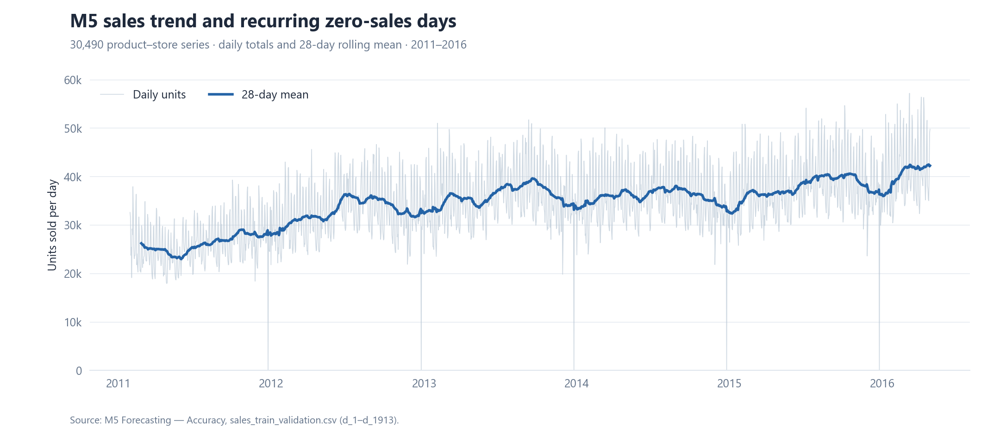
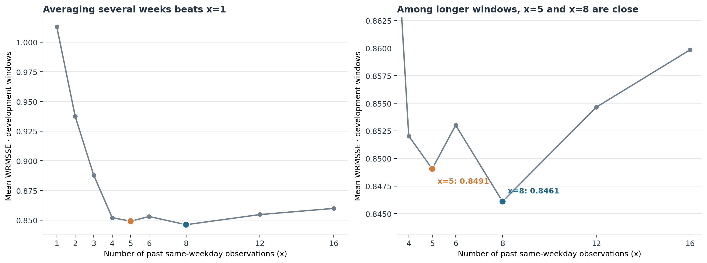
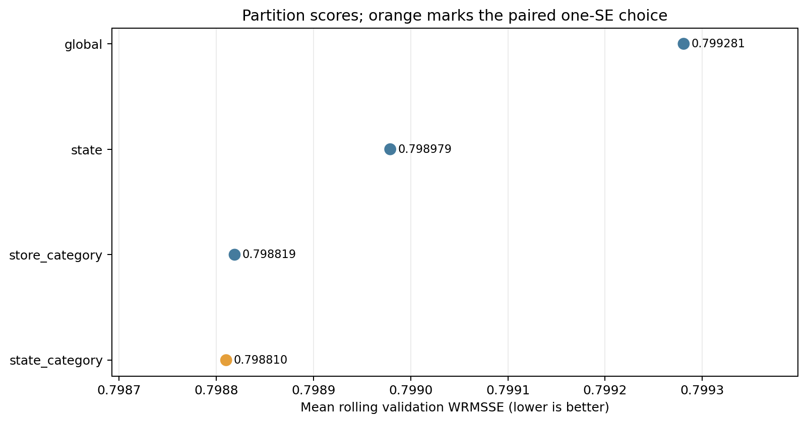
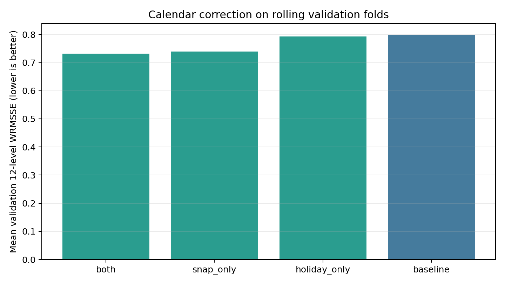
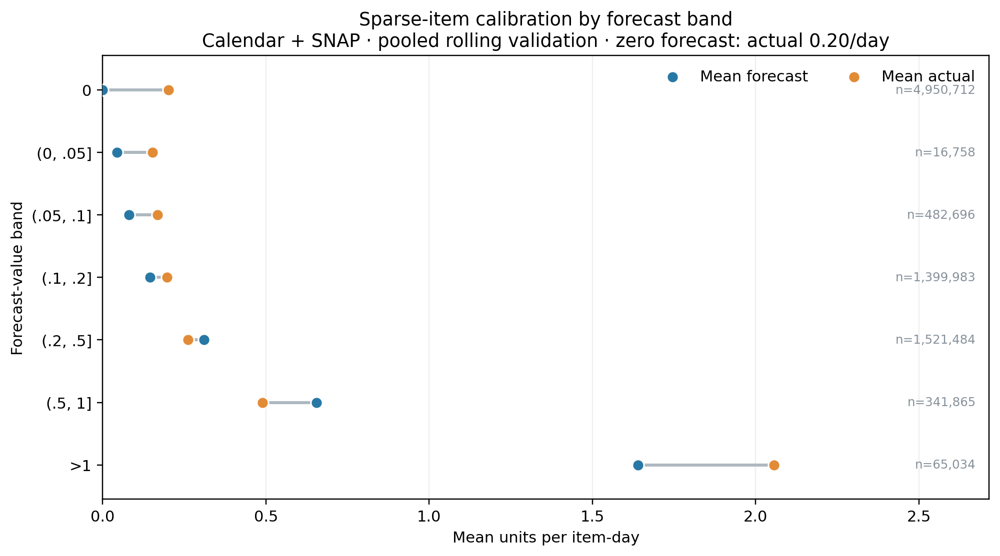
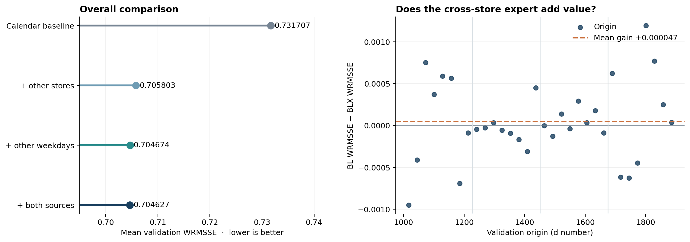

# Selected Experiment Results

The uploaded version retains statistical summaries, scores, parameter tables, and representative PNGs. Full leaf predictions, submission CSVs, per-series exploratory tables, and other figures can be regenerated with the corresponding scripts. JSON and CSV files describe saved results; see [forecasting experiments](../code/evaluation/README.md) for reproduction.

## Data exploration

Data-quality reports are under `data_prep/reports/`; other exploratory plots are under `data_prep/figures/`.

## Averaging windows and recency weights

## Calendar effects and sparse sales

## Information-borrowing mixture

The final selection is BLX with `kappa=80`. Local holdout WRMSSE scores are:

| Method | WRMSSE |
|---|---:|
| sNaive | 0.86970 |
| State-category recency weights | 0.73699 |
| Holidays and SNAP | 0.66136 |
| BLX | 0.65357 |

Results are recorded in JSON summaries under `evaluation/snaive/`, `evaluation/rho_selection/`, `evaluation/calendar_effect/`, and `evaluation/borrow_information/`.
