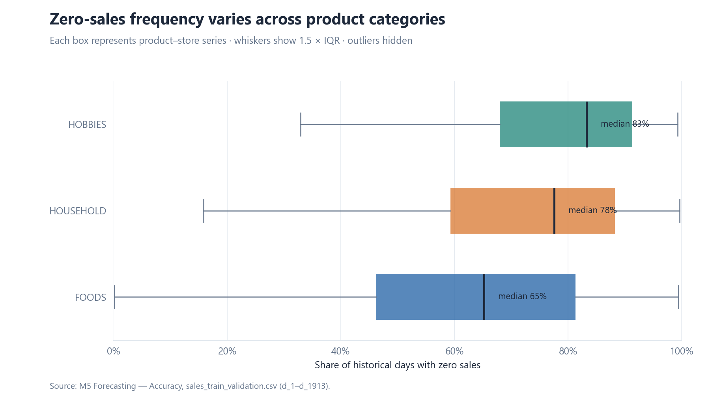
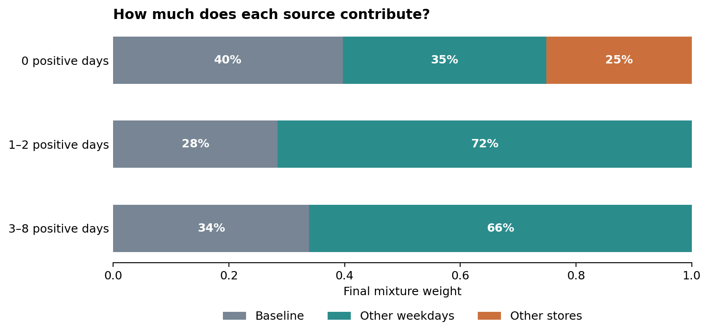

# 精选实验结果

上传版本保留统计摘要、评分与参数表，以及下列代表性 PNG。完整底层预测、提交 CSV、逐条序列探索表及其他图形可运行相应脚本生成。各目录中的 JSON 和 CSV 用于查看既有结果；完整复现按[预测实验说明](../code/evaluation/README.md)运行。

## 数据探索

数据准备报告位于 `data_prep/reports/`，其余探索图位于 `data_prep/figures/`。

## 平均窗口与近期权重

## 日历与稀疏销量

## 信息共享混合

模型最终选择 BLX、`kappa=80`。各阶段的本地留出期 WRMSSE 为：

| 方法 | WRMSSE |
|---|---:|
| sNaive | 0.86970 |
| 州×品类近期加权 | 0.73699 |
| 加入节日与 SNAP | 0.66136 |
| BLX | 0.65357 |

结果分别保存在 `evaluation/snaive/`、`evaluation/rho_selection/`、`evaluation/calendar_effect/` 和 `evaluation/borrow_information/` 的 JSON 摘要中。
